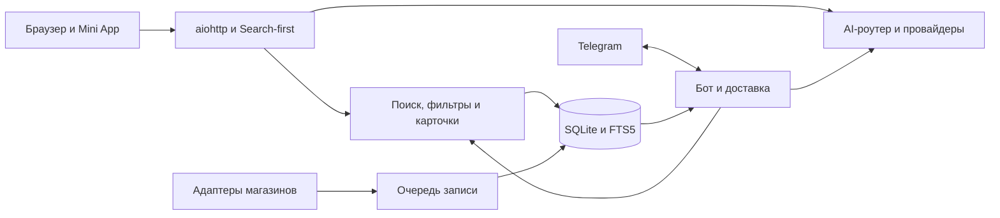

# Архитектура KZ Price Hunter

## Пользовательские сценарии

Браузер и Telegram Mini App работают с одним aiohttp-приложением. [gui.py](../gui.py) запускает HTTP-сервер, [web/server.py](../web/server.py) связывает маршруты, фоновые задачи и хранилище. [telegram_bot.py](../telegram_bot.py) отдельно обрабатывает Telegram-обновления. Сессии, доступ, Origin и reverse proxy проверяет [auth.py](../auth.py).

## Обход и запись

1. Планировщик выбирает магазины и категории по настройкам, состоянию обходов и сигналам спроса. Аренды и очереди защищают запись при конкуренции; состояние проверяется отдельно от HTTP-доступности.
2. Адаптер возвращает результат с признаками полноты или отказа. Входные предложения проходят валидацию, нормализацию и очередь записи. Устаревшие предложения оцениваются по состоянию обхода и фактической свежести.
3. Каталог хранит канонический товар, продавца, канал и предложение. Цена, доступность и город относятся к предложению. Названия и характеристики помогают сопоставлению, а спорные совпадения проходят дополнительную проверку по настройкам.
4. История и сигналы о цене питают ленту скидок и наблюдения. [notifier.py](../notifier.py) доставляет уведомления из очереди с учётом настроек, повторов и ограничений Telegram.

[Источники и категории](../SOURCES.md) · [Доменные модели](../domain/README.md) · [Сопоставление и арбитраж](MATCHING_AND_ARBITRAGE.md)

## Поиск и ИИ

Основной веб-путь использует API v2, репозитории каталога и FTS5. Предложения группируются по товару и фильтруются по городу, цене и характеристикам. [local_search.py](../local_search.py) разбирает запрос локальной моделью там, где этот путь включён. [ai_router.py](../ai_router.py) управляет провайдерами, бюджетами и резервными путями по задачам. Состояние конкретной среды определяется её настройками. [Требования поиска](LOCAL_AI_SEARCH_REQUIREMENTS.md) · [Политика ИИ](AI_LOCAL_POLICY.md)

## Хранение и эксплуатация

- В `DATA_DIR` расположены SQLite `prices.db`, `settings.json` и локальные файлы среды. SQLite использует WAL; согласованные снимки снимаются через Backup API.
- Redis, когда доступен, обслуживает очередь обработки. Готовность записи и состояние Redis отражаются в `/api/health`; подробный снимок предоставляет защищённый `/api/diag`.
- Прод и стенд имеют отдельные данные, настройки и Telegram-ботов. Прод получает образ из GHCR, стенд собирается из checkout.
- Центр мониторинга показывает обходы, ошибки, состояние очереди, AI и резервных копий.

[Диагностика](DIAGNOSTICS.md) · [Стенд](TEST_STAND.md) · [Прод и резервные копии](PROD_MOVE_P17E.md) · [Данные и безопасность](SECURITY_AND_PRIVACY.md)
